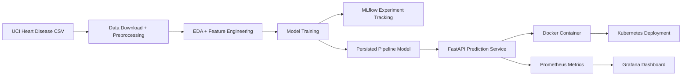

# Architecture Overview

This layout reflects the production-ready flow used in the assignment: raw data enters the pipeline, a trained model is validated and logged, then the packaged model is served through a containerized API, monitored, and exposed behind a Kubernetes service.
