# Heart Disease Risk Prediction — MLOps Report

- **Course:** AIMLCZG523 — MLOps
- **Assignment:** 01
- **Dataset:** UCI Heart Disease (Cleveland)
- **Name:** BADRINATHAN S.
- **Student ID:** 2025AE05369
- **Email:** 2025ae05369@wilp.bits-pilani.ac.in
- **Git Repository:** https://github.com/2025ae05369-badree/heart-disease-prediction-mlops.git
- **Google Drive Link:** To be provided

## 1. Objective

This project builds a binary heart-disease risk classifier from 13 clinical features and delivers it as a tested, containerized, monitored API. The workflow covers data preparation, exploratory analysis, model development, experiment tracking, packaging, continuous integration, deployment, and observability.

## 2. Reproducibility

The implementation runs locally with Python (managed via `.venv`) and `uv`. Setup and execution commands are documented in the repository [README](../README.md). The complete pipeline is started with:

```bash
python main.py
```

The pipeline downloads the dataset, preprocesses the data, generates EDA
outputs, trains both classifiers, records the experiments, and saves the
selected model.

## 3. Data and exploratory analysis

- **Source:** UCI Machine Learning Repository,
  `processed.cleveland.data`.
- **Cleaning:** `?` values are converted to missing values and imputed using
  numeric medians or categorical modes.
- **Target:** the original severity score (0–4) is converted to a binary
  target: `0` for no disease and `1` for disease present.
- **Dataset:** 303 rows, 13 features, and no missing values after cleaning.
- **Class distribution:** 164 negative and 139 positive records.

EDA outputs include feature distributions, a correlation heatmap, and class
balance visualizations in `outputs/figures/`.

**EDA visualizations:**

- Histograms for each feature
  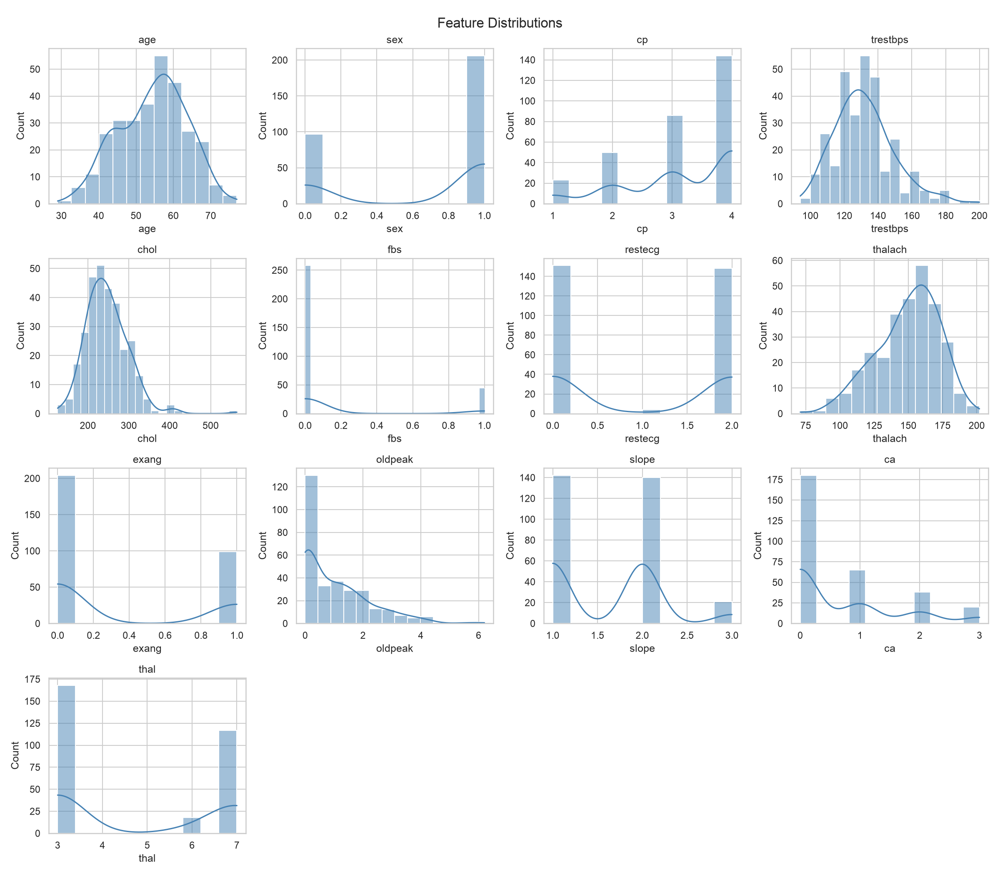
- Correlation heatmap
  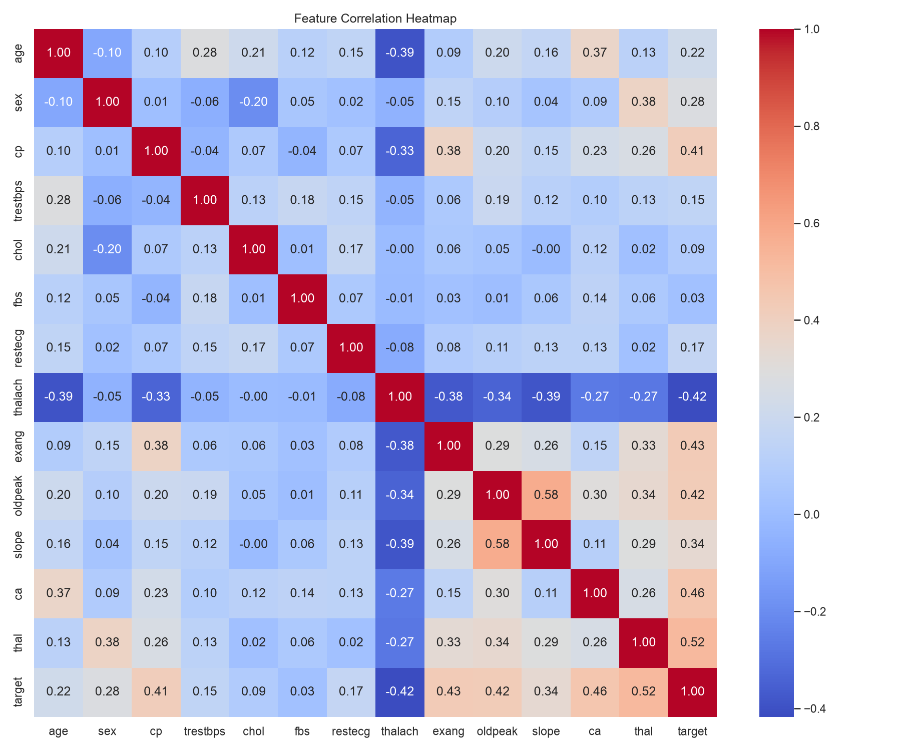
- Class balance visualizations
  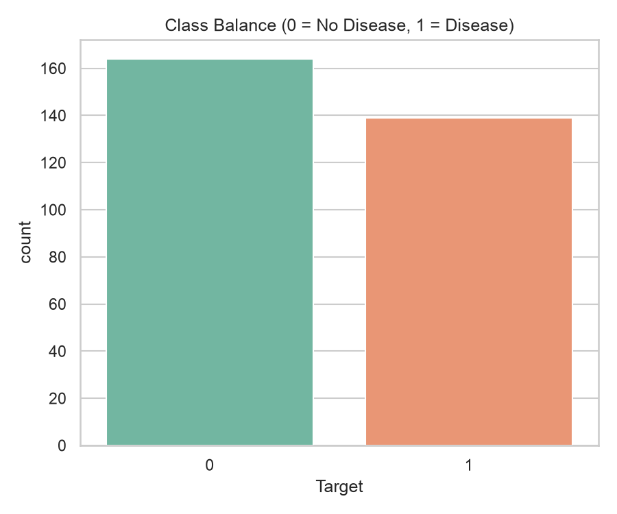

## 4. Feature engineering and model development

The feature pipeline uses a `ColumnTransformer`:

- Standard scaling for `age`, `trestbps`, `chol`, `thalach`, and `oldpeak`.
- One-hot encoding for `sex`, `cp`, `fbs`, `restecg`, `exang`, `slope`, `ca`,
  and `thal`.

Logistic Regression and Random Forest models were tuned with five-fold
stratified cross-validation using ROC-AUC as the optimization metric. Final
metrics were measured on a stratified 80/20 holdout set.

| Model               |      CV ROC-AUC | Test ROC-AUC | Test accuracy | Test precision | Test recall |
| ------------------- | --------------: | -----------: | ------------: | -------------: | ----------: |
| Logistic Regression | 0.9025 ± 0.0144 |   **0.9665** |    **0.8852** |     **0.8387** |      0.9286 |
| Random Forest       | 0.9024 ± 0.0279 |       0.9470 |        0.8689 |         0.8125 |      0.9286 |

Logistic Regression was selected because it achieved better holdout ROC-AUC,
accuracy, and precision with the same recall and lower cross-validation
variance.

**Logistic Regression:**

- Logistic Regression - Confusion matrix
  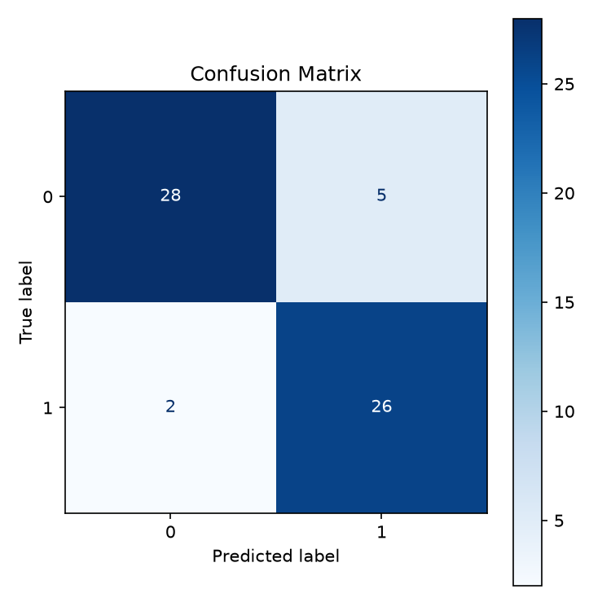

- Logistic Regression - ROC curve
  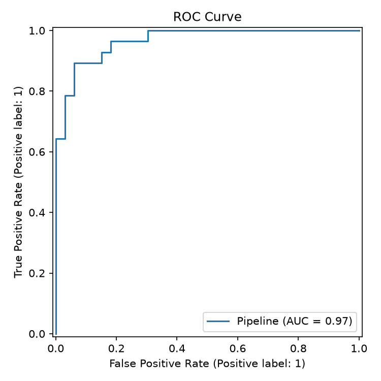

**Random Forest:**

- Random Forest - Confusion matrix
  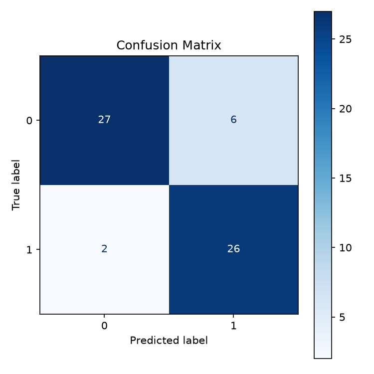

- Random Forest - ROC curve
  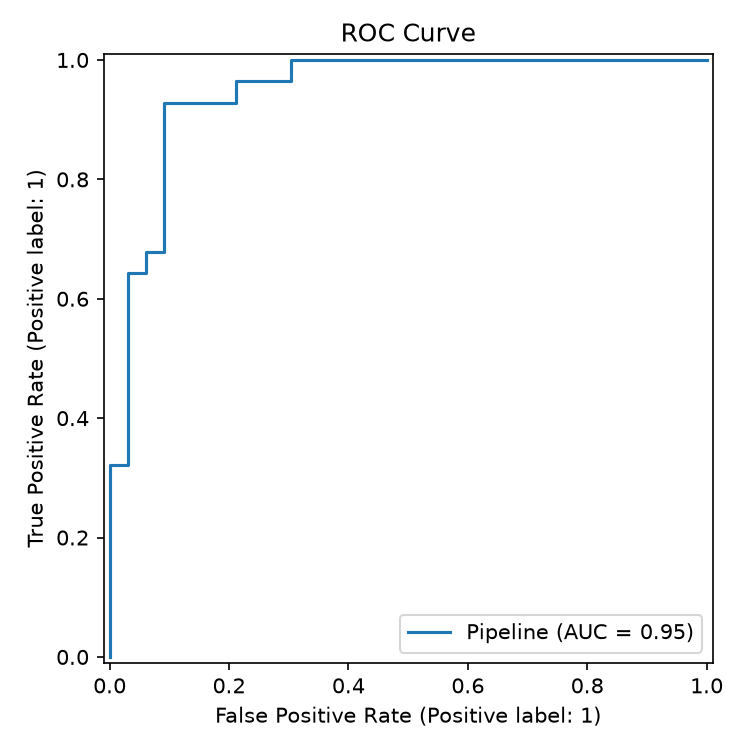

## 5. Experiment tracking and model packaging

MLflow runs locally and remotely with the `heart-disease-classification` experiment. Each
run records:

- Tuned model parameters.
- Cross-validation and holdout accuracy, precision, recall, and ROC-AUC.
- The fitted preprocessing-and-model pipeline.
- Confusion matrix and ROC curve artifacts.

The selected pipeline is saved to
`models/heart_disease_model.joblib`. Persisting preprocessing and prediction
as one artifact prevents training and serving transformations from diverging.
Dependencies are pinned in `requirements.txt`.


## 6. API and containerization

The FastAPI service exposes:

| Endpoint        | Purpose                                    |
| --------------- | ------------------------------------------ |
| `GET /health`   | Confirms that the model is available       |
| `POST /predict` | Returns prediction, probability, and label |
| `GET /metrics`  | Exposes Prometheus metrics                 |

The `PatientRecord` request model validates the 13 input features, and the
typed response model preserves the integer prediction value and response
schema. The Docker image uses Python 3.12, installs the pinned dependencies,
and serves the API on port 8000.


## 7. CI and automated testing

The test suite covers data cleaning, target encoding, model training, metric
generation, and model packaging. `flake8` checks code quality.

The GitHub Actions workflow runs the following sequence on pushes and pull
requests to the main branches:

```text
flake8 .  →  pytest -q  →  python main.py
```

**GitHub Actions workflow result**

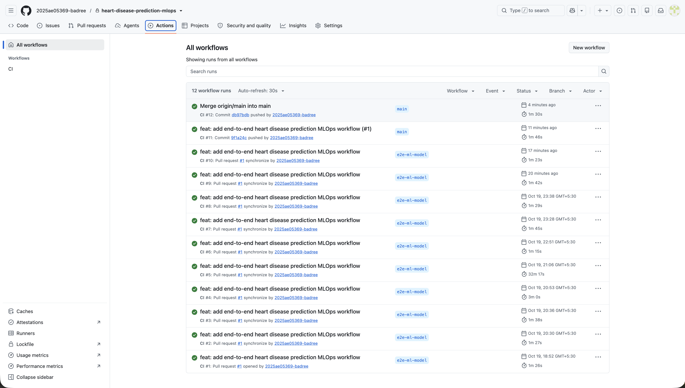

**Workflow triggers on pull requests and pushes to the main branches**

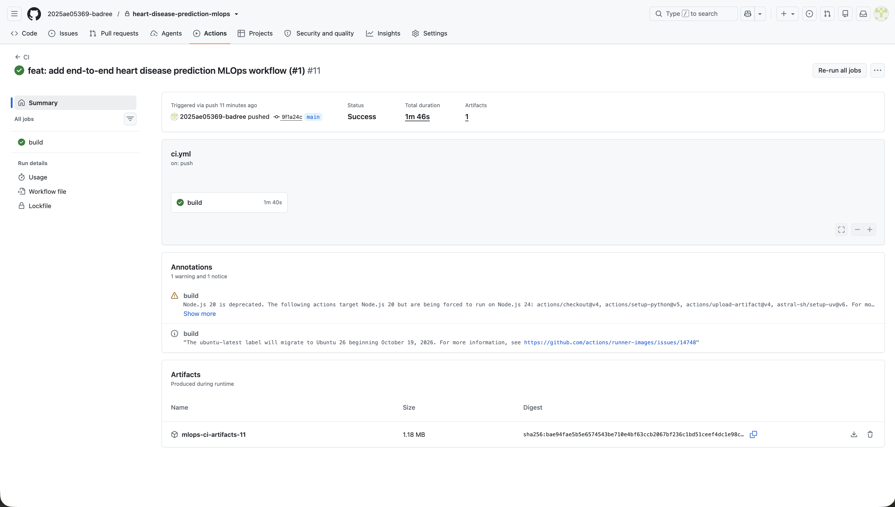
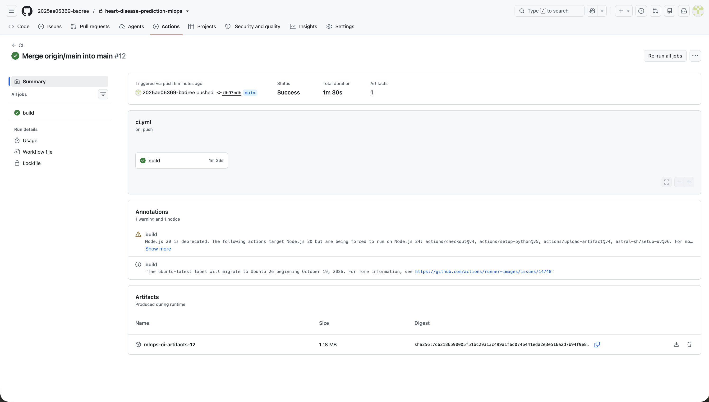
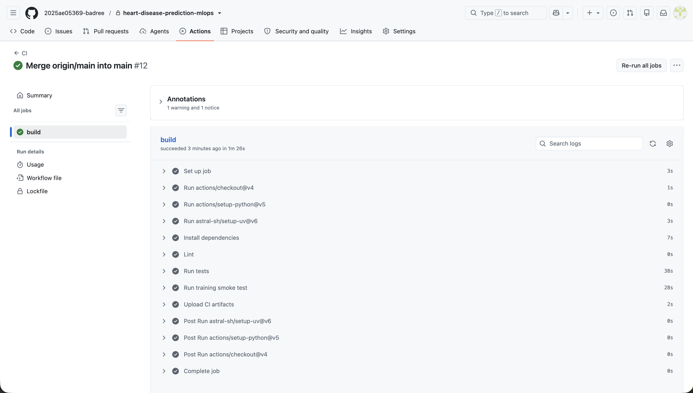

## 8. Deployment

`deployment.yaml` defines a Kubernetes Deployment with one API replica and a
Service that maps port 80 to the container's port 8000. The image can be
loaded into Minikube and exposed locally with `kubectl port-forward`.

Deployment verification requires:

1. A ready Kubernetes node.
2. A running API pod.
3. A reachable Service.
4. Successful health and prediction requests.


## 9. Monitoring and logging

The API logs health and prediction requests through Python logging, while
Uvicorn provides access logs. `prometheus-fastapi-instrumentator` exposes
request counts and latency histograms at `/metrics`.

The Compose monitoring stack provides:

- Prometheus for metric collection and queries.
- Grafana for the provisioned API dashboard.
- Recording rules for request rate, latency, success rate, and error rate.


## 10. Architecture

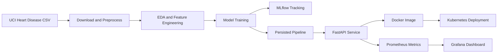

Data flows from the UCI dataset through preprocessing and feature
engineering into model training. The selected pipeline is tracked, persisted,
and served by FastAPI. Docker packages the service for local Kubernetes
deployment, while Prometheus and Grafana provide operational visibility.

## 11. Evidence register

The following image references are placeholders until the corresponding runs
are completed. Required filenames and capture guidance are maintained in
[`screenshots/README.md`](../screenshots/README.md).

| Evidence                  | Report reference                                                        | Status          |
| ------------------------- | ----------------------------------------------------------------------- | --------------- |
| EDA outputs               | `eda-visualizations.png`                                                | Pending capture |
| Model evaluation          | `model-evaluation.png`                                                  | Pending capture |
| MLflow comparison         | `mlflow-runs.png`                                                       | Pending capture |
| API health and prediction | `api-health.png`, `api-predict.png`                                     | Pending capture |
| CI workflow               | `ci-run.png`                                                            | Pending capture |
| Kubernetes deployment     | `deployment-overview.png`, `kubernetes-resources.png`                   | Pending capture |
| Monitoring                | `prometheus-query.png`, `grafana-dashboard.png`, `api-request-logs.png` | Pending capture |

## 12. Conclusion

The project implements a reproducible local MLOps workflow from raw data to a
monitored prediction service. Logistic Regression is the selected model based
on holdout performance, and the remaining deployment and evidence placeholders
can be completed by running the documented container, Kubernetes, monitoring,
and CI workflows.
